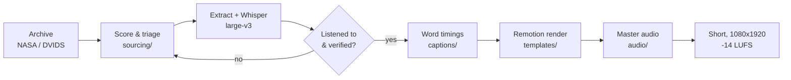

<div align="center">

# Shorts Video Pipeline

**The scripts behind a faceless YouTube Shorts channel: source real archival audio, transcribe it, caption it, render it in Remotion and master it to platform loudness.**


[](LICENSE)

</div>

---

## What's in here

| Folder | What it does |
| --- | --- |
| [`sourcing/`](sourcing) | Finds clips worth making a video about. Scores 3.9 million lines of Apollo 13 Mission Control transcript for tension language, searches the DVIDS military media API, transcribes candidates with Whisper, and checks that paired footage is the same incident. |
| [`captions/`](captions) | Turns whisper.cpp word timings into karaoke captions. Includes a fix for Whisper collapsing several words onto one timestamp on noisy radio audio. |
| [`templates/archival-hook-card/`](templates/archival-hook-card) | Remotion template: post-style card, hook headline, embedded footage window and captions over real archival audio. `new_video.sh` scaffolds a project in seconds. |
| [`audio/`](audio) | Two-pass ffmpeg mastering to -14 LUFS / -1.5 dBTP. One chain for AI voiceover with a ducked music bed, one for archival tape that is left untouched. |
| [`examples/trivia-ffmpeg/`](examples/trivia-ffmpeg) | A full trivia Short built with nothing but ffmpeg filters. |
| [`docs/`](docs) | Production standards (safe zones, captions, loudness, script craft) and the sourcing funnel. |

## How a video gets made



1. **Find a moment.** `score_transcript.py` ranks transcript windows by tension phrases, cluster density, how many channels are talking and speaker turnover. `sourcing_dvids.py` and `triage_titles.py` do the same for DVIDS releases.
2. **Pull and transcribe only the survivors.** `quality_extract_transcribe.py` fetches just the needed byte range of multi-hour tapes over HTTP and runs whisper large-v3. It's resumable from a checkpoint.
3. **Verify.** Someone listens to every clip end to end. `verify_footage.py` checks title match, resolution and frame brightness on paired footage.
4. **Build.** `new_video.sh <slug>`, drop in audio and footage, generate captions with `parse_whisper_timings.py`, edit `video.json` for the hook text, then render.
5. **Master.** `audio_archival.sh` or `audio_post.sh` measures, normalizes and remuxes, then prints an EBU R128 report.

See [docs/archival-funnel.md](docs/archival-funnel.md) for the full sourcing process and the bugs that shaped it.

## Requirements

- Python 3.10+ (standard library only)
- Node.js 18+ for Remotion
- ffmpeg and ffprobe
- [whisper.cpp](https://github.com/ggml-org/whisper.cpp) (`whisper-cli`) with the `ggml-large-v3.bin` model in `~/whisper-models/`
- A free [DVIDS API key](https://api.dvidshub.net) for the DVIDS scripts

## Quick start

```bash
git clone https://github.com/bsmith1698/shorts-video-pipeline.git
cd shorts-video-pipeline
cp .env.example .env            # add your DVIDS key

# One-time template install
(cd templates/archival-hook-card/remotion && npm install)

# New video
templates/archival-hook-card/new_video.sh my-first-short
```

Captions from a whisper.cpp JSON file:

```bash
whisper-cli -m ~/whisper-models/ggml-large-v3.bin -f clip.wav -ml 1 -oj -of clip
python3 captions/parse_whisper_timings.py wordTimings.json mission_audio=clip.json
```

Master a rendered video (expects `out/raw.mp4` inside the project folder):

```bash
audio/audio_archival.sh projects/my-first-short-short final.mp4 [music_bed.mp3]
```

## Notes

- Generated data (`queue.json`, `_archive/`), media files and `.env` are git-ignored. No footage, audio or API keys are in this repo.
- Archival audio and footage come from public-domain U.S. government sources. Check the rights on anything else you feed in.

## License

[MIT](LICENSE)
